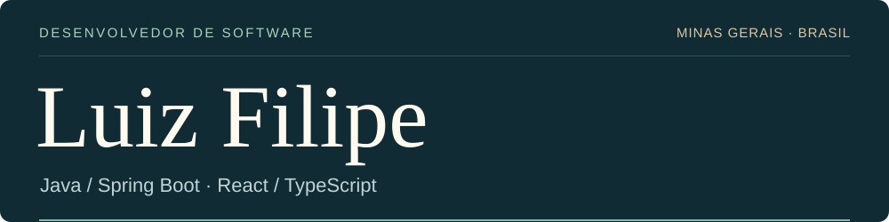
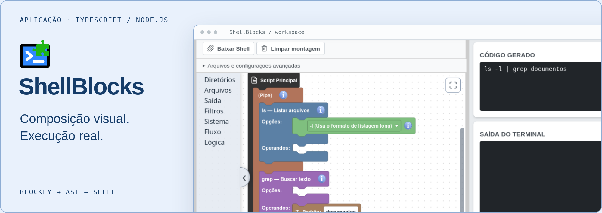
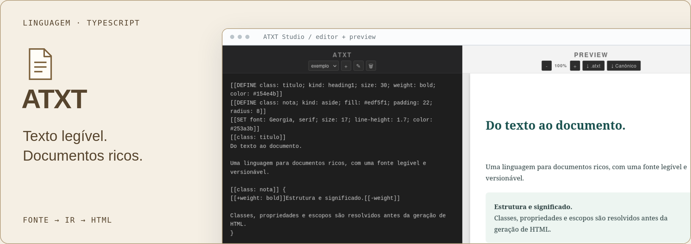

<picture>
  <source media="(max-width: 600px)" srcset="assets/header-mobile.svg">
  
</picture>

  
  
  

Tenho **23 anos** e sou de **Minas Gerais, Brasil**. Trabalho com sistemas empresariais em **SAP ABAP desde 2022**, desenvolvendo soluções de negócio, integrações e ferramentas.

Meu foco é **desenvolvimento full stack com Java, Spring Boot, React e TypeScript**, da modelagem e das APIs à interface e experiência de uso. Tenho facilidade com abstração e modelagem e gosto de criar DSLs, soluções declarativas e sistemas guiados por dados. Valorizo código legível, modularidade, testes e princípios SOLID.

## Linguagens e tecnologias

  
  
  
  
  
  
  
  
  
  

## Projetos em destaque

**Aprender linha de comando construindo e executando programas por blocos.** Comandos declarativos, validação contextual e AST própria, com backend Node.js que gerencia sandboxes Docker e seu ciclo de vida. A aplicação reúne progressão educacional, persistência e testes de integração. **Artigo aprovado e aplicação apresentada no Apps.Edu/CBIE 2026.**

**[Abrir o ShellBlocks ↗](https://shellblocks.duckdns.org/)** · [Explorar o código](https://github.com/Luiz-Filipe26/ShellBlocks)

 

**Documentos ricos com uma fonte legível e versionável.** Concebi a linguagem e implementei lexer, parser, resolução semântica, representação intermediária e geração HTML. Pilhas por propriedade resolvem estilos sobrepostos; identidade dos nós e localização na fonte permanecem separadas. O núcleo possui uma suíte extensa de testes.

**[Experimentar o ATXT Studio ↗](https://luiz-filipe26.github.io/atxt-editor/)** · [Código e especificação](https://github.com/Luiz-Filipe26/atxt-editor)

## Aplicações web

###  [Foodfy ↗](https://github.com/Luiz-Filipe26/Foodfy)

**Java · Spring Boot · PostgreSQL · Docker**

Backend para gerenciar um restaurante, com autenticação, cardápio, pedidos e estoque. APIs REST, JPA, comunicação entre serviços e testes integram as funcionalidades do sistema. Projeto acadêmico em dupla, disponível no meu perfil como fork.

###  [TechPass ↗](https://github.com/Luiz-Filipe26/TechPass) · [Demo](https://luiz-filipe26.github.io/TechPass/)

**React · TypeScript · Interface e experiência de uso**

Da descoberta da programação de um evento à escolha de assentos e à compra simulada de ingressos. Desenvolvi a aplicação individualmente para IHC, com navegação por loaders, Suspense e componentes reutilizáveis. O foco é a experiência no frontend, com serviços simulados.

## Jogos, modelagem e C++

###  [MonstersClash ↗](https://github.com/Luiz-Filipe26/Monsters-Clash)

**Kotlin · Android · MVVM · LiveData · SQLite**

Jogo de combate com cartas para Android, com uma mão interativa organizada em leque e seleção por gestos. Implementei todo o código-fonte, separando o estado da mão, o ViewModel e a apresentação reativa das cartas. A solução combina modelagem, persistência local e uma interface pensada para o toque.

###  [NavalBattle ↗](https://github.com/Luiz-Filipe26/NavalBattle)

**C++17 · SFML · CMake**

Batalha naval com interfaces de console e SFML sobre a mesma lógica. Ownership explícito com `unique_ptr`, transferência de recursos com `std::move` e uma interface polimórfica separam o jogo de sua apresentação. O bot usa uma máquina de estados para procurar e perseguir embarcações.

## Linguagens, dados e algoritmos

###  [gtasa-save ↗](https://github.com/Luiz-Filipe26/gtasa-save)

**TypeScript · Formatos binários · Schemas declarativos**

Um histórico versionado das partidas de GTA San Andreas: a proposta é acompanhar a evolução dos saves e comparar mudanças no estado do jogo, em vez de diferenças entre bytes sem contexto.

O `gtasa-save-engine` já interpreta estruturas dos saves por schemas declarativos, com layouts, condições, arrays dinâmicos e validações. Essa base alimentará o `gtasa-chronicle`, ainda em estágio inicial, no qual estão planejados o acompanhamento dos arquivos, o histórico e a comparação semântica do progresso.

###  [DeteccaoImagensIA ↗](https://github.com/Luiz-Filipe26/DeteccaoImagensIA)

**Java · Redes neurais · Backpropagation · Swing**

Uma aplicação para desenhar, reunir exemplos e treinar uma rede que distingue bonecos de palito de outros desenhos. Implementei o perceptron multicamadas e o backpropagation sem bibliotecas de machine learning, além da normalização espacial dos desenhos. A interface Swing permite experimentar o classificador e persistir os exemplos e o estado da rede.

###  [VSI Resolve ↗](https://github.com/Luiz-Filipe26/vsi-resolve)

**WebAssembly · WASM64 · C/C++ · ABI semântica · Late linking**

Uma arquitetura de distribuição de software que propõe entregar um único artefato intermediário, independente de processador e sistema operacional, e gerar o executável nativo na instalação. Uma ABI semântica descreve as operações de sistema; o resolvedor seleciona as implementações da plataforma de destino por *late linking*. O objetivo é executar a aplicação sem uma máquina virtual residente.

O subsistema de áudio é a primeira prova de conceito funcional desse percurso, usando WASM64, wasm2c e C. Ele valida a base da proposta; a ampliação para outros subsistemas permanece em desenvolvimento.

[Ver todos os repositórios →](https://github.com/Luiz-Filipe26?tab=repositories)
